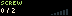

# Pick List

Pick the exact quantity of each part, skip missing lines, and check the remaining kit.

Configure a kit as Part|quantity;Part|quantity. The wheel selects a line, click picks one unit and Start removes one picked unit. Hold the wheel jumps to the next incomplete line, including earlier skipped parts. The front turns complete only when every required quantity is picked.

## Run locally

From this folder, run `~/.busy-emulator/bin/busy-emulator dev --once` with BUSY Bar Emulator open. Back exits.

